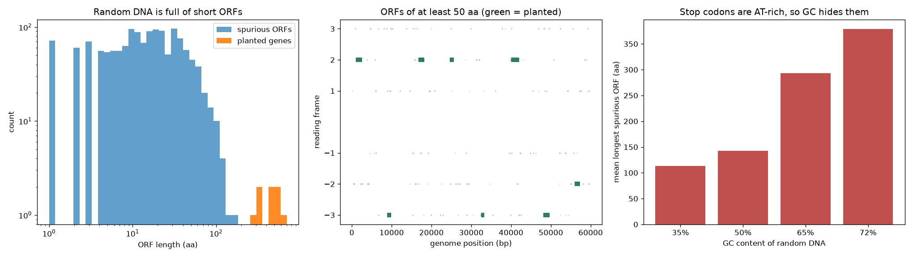

# Six-Frame ORF Finder

> An open reading frame is not a gene. It is a stretch of DNA that hasn't hit a stop codon yet.

## Demo Output



Produced from simulated DNA by `demo.py`: real (planted) genes against the swarm of spurious ORFs that random sequence produces, and how GC content stretches those fakes out.

## Why This Exists

Finding ORFs takes about 40 lines of code. Deciding which ones matter is the hard part. This repo finds ATG-to-stop ORFs in all six frames, then puts the finder in a setting where you know the answer: eight genes planted in 60 kb of random DNA. Sweep the minimum-length cut-off and watch the trade-off between finding real genes and calling noise.

## How It Works

1. Translate each of the three frames on the forward strand and the three on the reverse complement.
2. In each frame, open an ORF at the first ATG and close it at the next in-frame stop (TAA, TAG, TGA).
3. Report coordinates on the + strand, so the two strands can be compared directly.

```python
from orf_finder import find_orfs
orfs = find_orfs(sequence, min_aa=100)
```

## Choosing a Length Cut-off

| Genome | Sensible starting cut-off | Why |
|--------|---------------------------|-----|
| Bacterial, ~50% GC | 100 aa | Random ORFs above this length are rare |
| GC-rich (over 65%) | 150 aa or more | Stops (TAA, TAG, TGA) are AT-rich, so they turn up less often |
| Viral or compact | 50 aa with homology support | Real small proteins exist |
| Eukaryotic genomic DNA | Don't use ORFs alone | Introns break genes into pieces |

## When NOT to Use This

- **Eukaryotic genes with introns.** Use a gene predictor that models splicing (for example AUGUSTUS).
- **Alternative start codons** (GTG, TTG) are common in bacteria. Pass `starts=("ATG", "GTG", "TTG")` if you need them.
- **Small ORFs and smORFs.** A length cut-off will throw away real micro-proteins.

## The Uncomfortable Truth

In a 72% GC genome, random sequence produces ORFs long enough to pass most naive filters. Gene finders exist because length alone has no idea what a gene looks like. Codon usage, ribosome binding sites and homology do the real work.

## Further Reading

- Fickett J. W. "Recognition of protein coding regions in DNA sequences." Nucleic Acids Research (1982).
- Delcher A. L. et al. "Improved microbial gene identification with GLIMMER." Nucleic Acids Research (1999).
- Hyatt D. et al. "Prodigal: prokaryotic gene recognition and translation initiation site identification." BMC Bioinformatics (2010).
